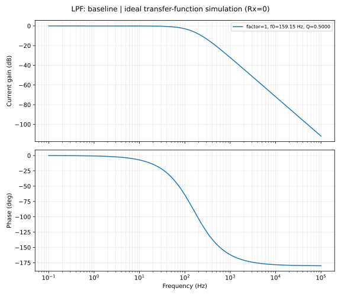
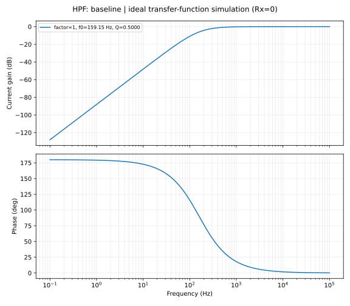
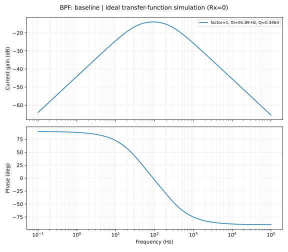
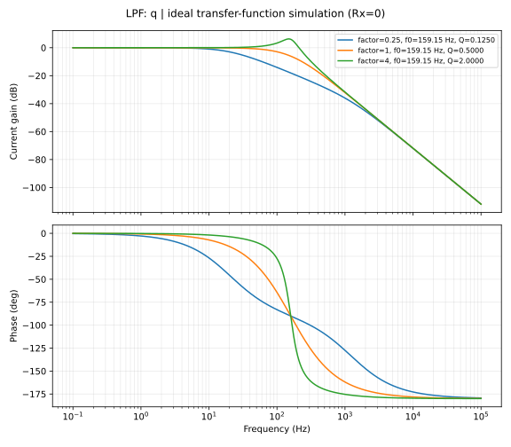
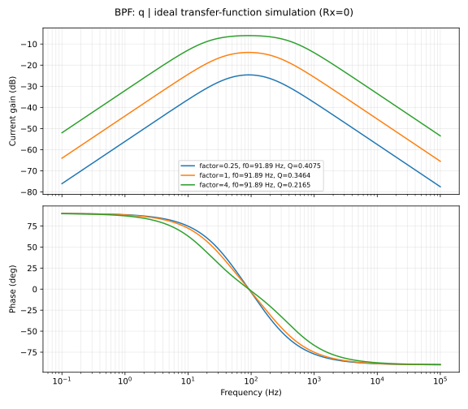
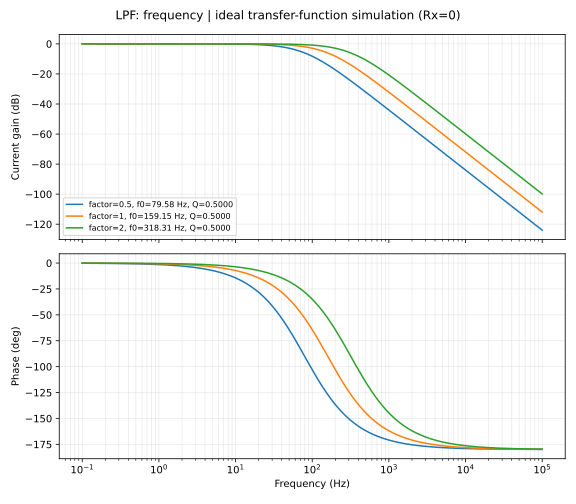
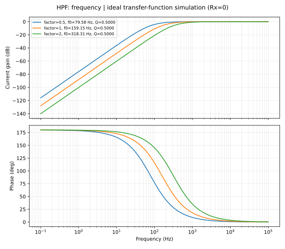
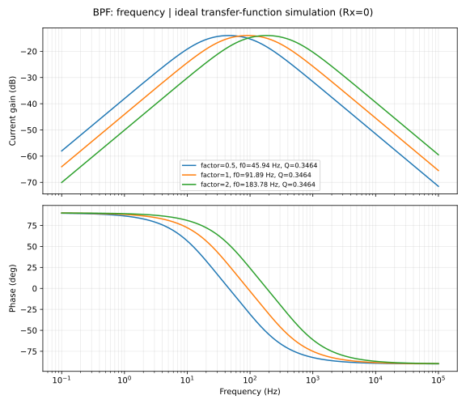

# 可重現實驗 / Reproducible experiments

在 repository 根目錄執行 / Run from repository root:

```bash
python -m venv .venv
# Linux/macOS: source .venv/bin/activate
# Windows PowerShell: .venv\Scripts\Activate.ps1
python -m pip install -r requirements.txt
python -m unittest discover -s tests -v
python run_experiments.py
```

`results/environment.json` 記錄本次實際套件版本；requirements 指定相容範圍，不是鎖定環境。無需原 PDF 或外部資料即可執行。頻率為 0.1–100000 Hz、2001 個對數點；增益用 20log10(|Io/Iin|)，相位用 unwrap 後的角度，非功率增益。

Environment versions are recorded in the generated JSON. Each case exports frequency, linear magnitude, gain dB and unwrapped phase degrees. The runner cross-checks SciPy frequency response, while unit tests independently solve the nodal system.

## 原始參數 / Source parameters

| Filter | Conductance | Capacitance | w0 (rad/s) | f0 (Hz) | Q |
|---|---|---|---:|---:|---:|
| LPF | G2=G4=1 mS (R=1 kΩ) | C1=C3=1 μF | 1000 | 159.154943 | 0.5 |
| HPF | G1=G3=1 mS (R=1 kΩ) | C2=C4=1 μF | 1000 | 159.154943 | 0.5 |
| BPF | G1=G3=G4=1 mS (R=1 kΩ) | C1=C2=C3=1 μF | 577.350269 | 91.888149 | 0.346410 |

來源為原報告 p11–12；數值欄為本次修正式理論計算。基準 LPF/HPF 在 f0 的幅度為 0.5（−6.0206 dB），不是 −3 dB；BPF 峰值為 0.2（−13.9794 dB）。LPF/HPF 的 f0 為極點自然頻率，不能直接叫截止頻率；BPF 的 f0 才對應峰值中心。

## 調參設計 / Tuning design

| Sweep | LPF | HPF | BPF |
|---|---|---|---|
| Fixed w0, varying Q | G4×t、G2÷t | G1×t、G3÷t | G4×t |
| Frequency | 所有 G×t / all G×t | 所有 G×t / all G×t | 所有 G×t / all G×t |

Q 掃描 t=0.25,1,4；頻率掃描 t=0.5,1,2。掃描完整元件值在 `summary.csv` 的 parameters_si 欄。G 倍增等於 R 減半；全部 C 除以 t 亦可得到相同頻率倍增且 Q 不變（未另外輸出此等價掃描）。

LPF: Q=0.5t，固定自然頻率，可看到高 Q 峰化。HPF: 固定 C 時 Q=1/(t+1/t)，最大 0.5；t 與 1/t 的曲線重疊是預期現象。要超過 0.5 可改 C4/C2 比值並同步調整其乘積。BPF: Q=sqrt(3)/(4+t)，峰值=t/(4+t)；G4 同時改變 Q 與峰值，不能當作獨立增益控制。

Frequency sweep scales every conductance by t, yielding w0×t with invariant Q. Q sweeps preserve w0 but have topology-specific limits. In particular, the HPF reciprocal ratios overlap, and BPF tuning changes peak gain as well as damping.

[完整掃描數值 / All cases](../results/summary.md)











## 驗證與證據等級 / Validation and evidence

| 類型 / Type | 現況 / Status |
|---|---|
| 原始報告結果 / Historical report | p11–12 有 gain/phase 圖，稱為實驗結果；儀器、原始點、接線與誤差資料未提供，未數位化或計算擬合誤差 |
| 理論 / Theory | 依來源重建拓撲、KCL、係數與解析 w0/Q |
| 新增模擬 / New simulation | Python 理想傳輸函數數值運算；21 cases、9 SVG、21 response CSV、1 summary CSV |
| 實際量測 / New measurements | 無；未宣稱重新接線、示波器量測或 SPICE 電晶體驗證 |

本次本機執行 `python -m unittest discover -s tests -v`：**7/7 通過**。項目：基準 w0/Q；隨機元件獨立節點解（每種 8 組、每組 71 點）；SciPy 對照；端點增益與 f0 相位；極點穩定性與調參不變量；BPF 半功率頻寬；dB 定義與非法輸入。沒有將理想模擬與舊報告曲線間的差距寫成已驗證誤差。

Local validation passed all seven test methods. GitHub Actions is configured to rerun tests and regenerate outputs; its remote result must be checked separately after publishing. There is no measured-data agreement claim.
